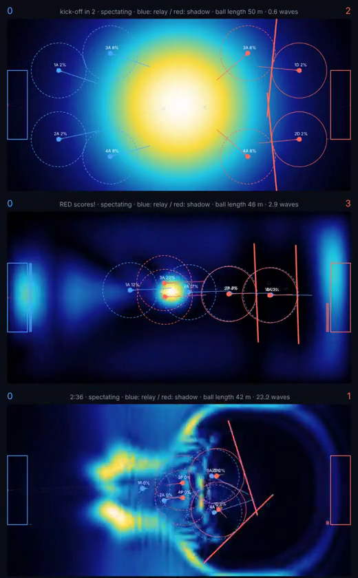

# Three ways to play: default, waves, additive walls

> **History (2026-11-01).** This file documents the force-kick model. With the catch/kick model (PHYSICS.md section 3) the presets are only `default` and `additive`; `waves`, `waves-kick`, `waves-well`, `waves-wall`, `waves-mass` and `hybrid` were removed (their `kick`, `wallHeight` and well settings no longer exist, and their attenuation of 1 wipes out any kick within a second). The new default keeps the `waves` value of `hbar/m = timeScale / mass = 24`, chosen for fringe spacing (PHYSICS.md 2.3), with light attenuation (0.02).
>
> **Stale numbers (older):** the tables and the bot results below were measured with the old stances (Attack, Defense as a repulsive wall, Pass) and the old velocity-drag orders. The stances are now Defense, Pass, Shot, Dribble (see SPEC.md and PHYSICS.md section 3); rerun `node tools/variants.js <preset>` before relying on them. The `wallHeight` slider now sets the depth of Defense's wide catch well.

Which parameter set is the most fun to play, and which gives a human the most interesting options? This is a reasoned comparison, **not a playtest**:
nobody has played these with a mouse. The evidence is (1) frames and videos of bot matches, (2) numbers from `node tools/variants.js [preset]`
(bots, 120 s matches, single deterministic runs: indicative only, a small change can swing a count by a few goals).

## The variants (presets in `sim.js`, `PRESET=<name> node server.js`)

| Preset | What changes | Why |
|---|---|---|
| `default` | the tuned defaults (ball length about half the pitch) | the baseline |
| `waves` | time speed 12, mass 0.5, attenuation 1, kick 0.3, wall 1, well 0.3 | **2 to 3 waves across the pitch length** instead of about 15 |
| `additive` | default physics, but wall rebounds add probability instead of interfering | **no destructive interference at the walls** |
| `hybrid` | waves + additive + well 1 | an experiment, see below. Not recommended |

*Waves across the width* is `N = W * k_rms / 2 pi` (`wavesAcrossWidth()`): the lowest standing mode reads 0.5, a plane wave with three wavelengths reads 3.
The default had a median N of about 16 over the bot matches (the fine "gravel" in screenshots); `waves` brings it to 2.7. Two honest limits: N swings a lot in time
(it is above 3 for a good share of the match, only about a third of the time is inside 2-3), and the literal "final match" `plow` vs `plow` stays near 1.2 in `waves`:
two lines of walls only push the ball slowly and cannot excite short waves.

*Additive walls* unfold the pitch into a mirrored 2W x 2H torus. The ball evolves freely there and the pitch shows the **sum of the densities of the four mirror images**:
a rebound adds probability, never cancels it, so there are no nodes at the walls (test: wall-cell density is 0.94 of the peak against 0.21 for the coherent wall).
The ball still interferes with *itself* (kicks, wells and walls make fringes), only the wall rebound is incoherent. It costs a 4x larger grid.

## Measurements (bots, 6 pairings, 120 s each; options: 90 s)

Refreshed after auto-aim and the symmetry fix (`docs/ASYMMETRY.md`); the first version of this table (before auto-aim) is in the git history and ranked the variants differently.

| | default | waves | additive |
|---|---|---|---|
| median waves across the width | 15.8 | **2.8** | 18.7 |
| ball length L (m), mean | 43 | 40 | 39 |
| time with L in 35-65 m | 64 % | 67 % | 43 % |
| goals per match, both sides | **5.2** | 3.0 | 4.2 |
| standing pass: ball shifted (m) | +21 | +14 | +16 |
| attack "carry" for 10 s: ball shifted (m) | +3.6 | **-17** | +3.3 |
| bot styles that score unopposed in 90 s (of 6) | **5** | 4 (one goal each) | 4 |
| bot styles that beat the fortress bot | 4 | **0** | 4 |
| goals vs the fortress, best style | 6 (receiver, shadow) | 0 | 6 (shadow) |

Bot styles: `turns receiver shadow relay plow lanes`. "Carry" = one attacker running at 6 m/s with the well on; a negative number means the ball escaped backwards. `hybrid` was not rerun (it was worse than both parents before auto-aim).

## Small tunings around `waves` (about three waves: a wavelength of a third of the pitch)

Same pool, auto-aim on. Median waves is averaged over the six pairings, so it includes the `plow` vs `plow` pairing that stays near 1.2 in every row.

| Preset | change from `waves` | median waves | goals/match | mean L (m) |
|---|---|---|---|---|
| `waves` | kick 0.3 | 2.8 | 2.3 | 38 |
| `waves-kick` | kick 1 | 3.1 | **4.5** | 42 |
| `waves-well` | kick 0.6, well 0.6 | 3.3 | 4.2 | 41 |
| `waves-wall` | kick 0.6, wall 2 | 2.9 | 3.2 | 35 |
| `waves-mass` | kick 0.6, mass 0.6 | 3.0 | 3.3 | 40 |

All keep the 2.8-3.3 waves. A stronger kick or a deeper well buys back most of the goals the smooth regime loses; a higher wall shrinks the ball (L 35 m); a heavier ball changes little.

## What it looks like

- **default**: speckle. Many fine fringes (15 waves): the ball looks like gravel and a kick, a wall and a well all end up as the same noise. Information is there but hard to read by eye.
- **waves**: smooth lobes that the walls visibly carve and the players visibly feed. When a line of walls moves, you see the ball bunch up in front of it and leave a shadow behind. This is the clearest picture of cause and effect of the three.
- **additive**: crisp travelling fronts, a ring spreading from a kick, and bright bands piling up along the walls (no nodes there, so the ball "sticks" to the pitch edge and into the corners). Easy to read, but the edges become dominant.

## Which is more fun, and which has the better options?

**To watch: `waves`.** The shapes are large, slow and attributable. A viewer can follow what a team is doing, the aim lines now show where the kicks go, and L stays near half the pitch for two thirds of the match.

**For options (after auto-aim): `default` and `additive` lead, `waves` trails.**
- `default` has the most ways to score (5 of 6 styles unopposed, 4 beat the fortress) and the most goals. Its weakness is legibility: 16 waves look like gravel.
- `additive` is close on options (4 and 4, shadow scores 6 against the fortress) and reads better than `default`: a rebound adds probability, so the wall becomes a tool instead of a trap. Its cost is a smaller ball (L is between 35 and 65 m only 43 % of the time: the ball piles along the walls).
- `waves` is the most watchable and the weakest at scoring: the fortress bot still concedes nothing, carrying the ball fails, and attackers get about one goal each. The `waves-kick` and `waves-well` tunings recover most of it (4.5 and 4.2 goals per match) while keeping three waves.

**Recommendation.** Combine what each does best, in this order, re-measuring with `node tools/variants.js <preset>` after each step:
1. Start from `waves-kick` (three waves, 4.5 goals/match) rather than `waves`.
2. Try the additive walls on top of it. Last time, mixing presets by hand (`hybrid`) went badly, so judge it by the table, not by hope. The goal strips sit at the walls, which is where additive walls help most.
3. Weaken defence in this regime (lower wall, or shorter reach for defenders) until the fortress concedes at least one style's worth of goals.
4. Restore carrying (well + reach together; depth alone did not work).

## Caveats
- Bots are not humans; the "options" counts are how many *scripted* styles work, a proxy for how many *human* ideas work.
- Single runs; the pool is six pairings (`relay` vs `shadow` is the one used for the replays); the sim is deterministic but chaotic, so neighbouring settings swing goal counts by a few.
- Waves across the width is measured on the whole field (RMS wavenumber along x): a few fast ripples raise it. The median is the fair number; the mean is higher.
